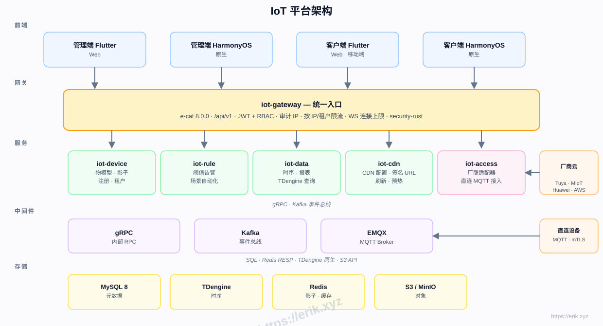
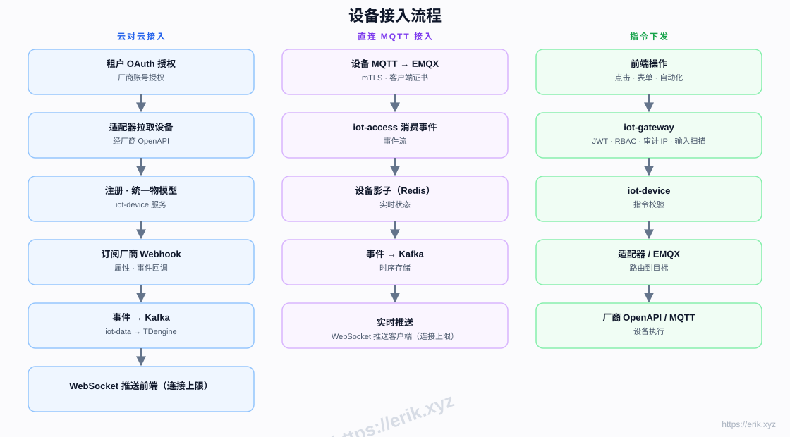
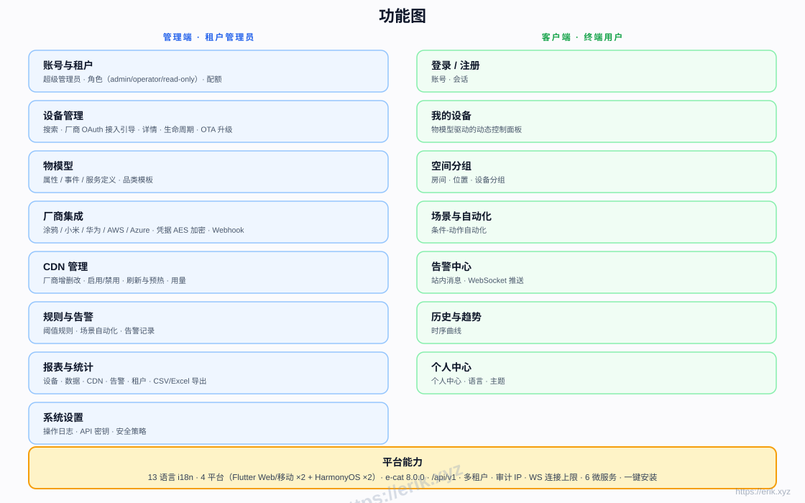
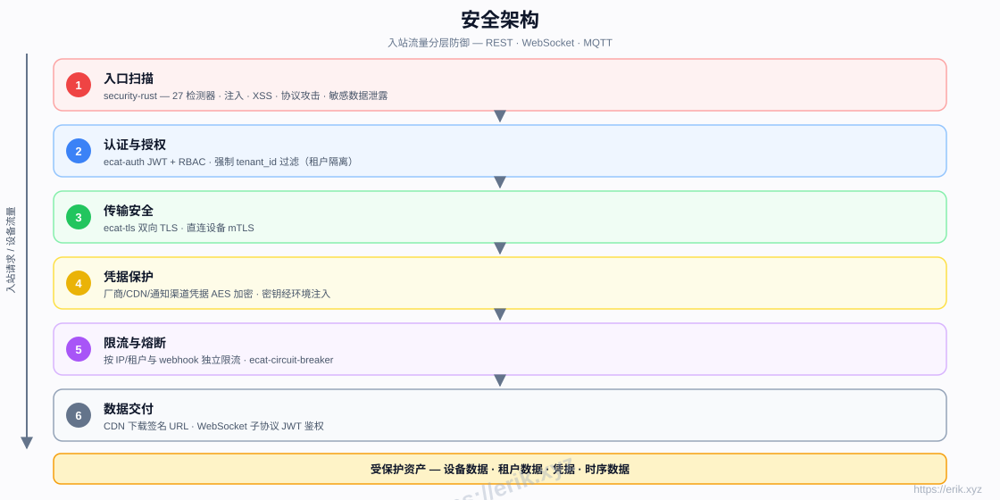

# IoT 物联网管理平台

[中文](README.md) | [English](docs/i18n/README.en.md)

<p align="center">
  
</p>

统一接入国内外主流设备厂商（涂鸦、小米、华为、AWS IoT、Azure IoT 等），提供设备管理、物模型、规则告警、时序数据、CDN 分发与多端应用的一站式 SaaS 物联网平台。后端为 Rust 微服务（e-cat 工作区），前端为 Flutter + HarmonyOS 双端。界面支持 13 种语言，文档提供中文 / English。

## 功能特性

- **多厂商接入**：云对云 OAuth（涂鸦 / 小米 / 华为 / AWS / Azure）+ 管理端配置厂商 AK/SK；直连 MQTT 支持 TLS / mTLS 与用户名密码
- **物模型**：属性 / 事件 / 服务统一建模，管理端建模、客户端动态渲染
- **设备生命周期**：注册 → 启用 / 禁用 → 解绑 → 删除，运行时在线 / 离线状态；设备详情（物模型、告警、指令、标签）、分组与批量创建
- **规则与告警**：阈值规则、场景自动化（属性 / 时间条件 + 指令 / 通知动作，可手动执行）、通知中心、通知渠道、WebSocket 实时推送
- **数据与报表**：TDengine 时序存储、历史曲线、CSV 导出
- **OTA 升级**：固件 URL 登记或二进制上传、S3 / MinIO 存储、CDN 签名下载 URL、下载统计、按设备哈希分桶的灰度批量下发、失败回滚
- **CDN 管理**：厂商配置、启用 / 禁用、刷新与预热、签名 URL
- **多租户 SaaS**：租户隔离、配额、平台超管、角色权限（admin / operator / read-only）
- **安全**：security-rust 入站扫描、JWT + RBAC、PBKDF2 口令、双向 TLS、凭据 AES 加密、按租户限流与熔断、审计日志（保留 90 天）；MQTT 生产加固（EMQX HTTP 认证/授权 + 设备凭据）
- **可观测与压测**：Prometheus `/metrics`、告警规则（服务不可达 / 5xx / P95 / Kafka 积压 + kafka-exporter）、`ecat-bench` CLI 与 `scripts/bench.sh`
- **13 语言界面**，Flutter Web / Mobile 与 HarmonyOS 原生四端

## 架构图



## 设备接入流程图



## 功能图



## 生命周期图


## 安全架构



## 技术栈

| 层 | 技术 |
|----|------|
| 前端 | Flutter（Web / Mobile）· HarmonyOS ArkTS |
| 后端 | Rust（axum · tokio · gRPC）· security-rust 安全扫描 |
| 中间件 | EMQX（MQTT）· Kafka（事件总线）· gRPC（内部 RPC） |
| 存储 | MySQL 8（元数据）· TDengine（时序）· Redis（影子 / 缓存）· S3 / MinIO（对象） |
| 接入 | 云对云 OAuth 适配器 · 直连 MQTT（mTLS） |

## 目录结构

```
├── apps/            # 前端应用
│   ├── admin/       # 管理端（Flutter + HarmonyOS）
│   └── client/      # 客户端（Flutter + HarmonyOS）
├── e-cat/           # Rust 工作区（框架 + 业务微服务一体）
│   └── ecat*/       # 框架公共库 + 业务微服务（ecat-gateway · ecat-device · ecat-access · ecat-rule · ecat-data-service · ecat-cdn · ecat-edge 等）
├── docs/            # 文档、架构图、打赏图片
├── scripts/         # 构建 / 校验 / 冒烟 / 压测脚本（install.sh · bench.sh · loadtest.sh）
└── docker-compose.yml  # 基础设施编排（MySQL / Redis / EMQX / Kafka / MinIO / TDengine）
```

## 一键安装

```bash
git clone https://github.com/erikwang2013/iot-platform.git
cd iot-platform
./scripts/install.sh
```

脚本将自动完成：拉起基础设施（MySQL / Redis / EMQX / Kafka / MinIO / TDengine）→ 构建 6 个业务服务 → 生成 .env（JWT / 网关 / 加密 / 口令 pepper / EMQX 认证等 32 字节随机密钥与初始管理员口令）→ 打印逐个服务的启动命令（已带 `.env` 加载）。重复运行安全，已存在的 `.env` 不会被覆盖。

## 单机 Docker Compose 部署

面向单机生产 / 小规模交付的独立编排（不替换根目录开发用 `docker-compose.yml`）：数据、基础设施日志与密钥全部落在 `deploy/compose/data/`，业务容器日志由 Docker local 驱动限制为 10 MiB × 3；只发布 nginx 80/443 与 EMQX 8883，业务容器只读根文件系统并以非 root 运行。

```bash
# 唯一手工项：把域名证书放到 deploy/certs/（fullchain.pem / privkey.pem）
sudo scripts/init-prod.sh                 # 生成 .env、内部 CA/EMQX 证书、数据目录，并打印 admin 初始口令
docker compose -f deploy/compose/docker-compose.yml up -d --build
# 可选监控（Prometheus / Grafana，Grafana 仅绑 127.0.0.1:3000）
docker compose -f deploy/compose/docker-compose.yml --profile monitoring up -d
```

`scripts/init-prod.sh --regenerate` 轮换应用密钥：旧 `.env` 备份到 `deploy/compose/backups/`，旧加密密钥保留为 `IOT_CRED_ENCRYPT_KEY_OLD`，基础设施口令不自动轮换。完整步骤、端口、备份与未验证项见[单机部署指南](docs/deploy/single-machine.md)（[English](docs/deploy/single-machine.en.md)）。

## 安装说明

### 前置依赖

- Docker 24+ 与 docker compose（或 docker-compose）
- Rust 1.80+（stable，用于编译业务服务；已安装 cargo 时脚本自动构建）
- 端口占用检查：8080-8085、3306、6379、1883、9092、9000-9001、6041 需空闲

### 安装步骤

1. 安装并启动基础设施：`./scripts/install.sh` 会执行 `docker compose up -d`
2. 构建业务服务：脚本检测到 cargo 后自动 `cargo build --release`，二进制输出至 `scripts/bin/`（或直接使用 `e-cat/target/release/` 下的产物）
3. 启动服务：按脚本末尾打印的命令逐个启动 6 个业务服务（命令已包含 `set -a; . <项目>/.env; set +a`）
4. 数据库迁移：服务启动时自动执行，无需手动操作；首次启动 iot-access 会创建默认租户与管理员账号，初始口令取 `.env` 的 `ADMIN_INITIAL_PASSWORD`

### 环境变量（节选）

| 变量 | 服务 | 说明 |
|------|------|------|
| `OTA_S3_ENDPOINT` / `OTA_S3_REGION` / `OTA_S3_BUCKET` / `OTA_S3_ACCESS_KEY` / `OTA_S3_SECRET_KEY` | iot-device | 固件存 S3 / MinIO；端点、桶与密钥必须同时配置（部分配置时上传接口报 500，不会静默回落本地盘）；`OTA_S3_REGION` 缺省 `us-east-1` |
| `OTA_PUBLIC_BASE` | iot-device | 固件公开源站前缀，把 `s3://bucket/key` 或相对路径转换为 CDN 可签名 URL |
| `OTA_CDN_PROVIDER_ID` | iot-device | 用该 iot-cdn 厂商给固件签下载 URL；未配置时任务 URL 退化为源站 URL |
| `OTA_SIGN_EXPIRES_SECS` | iot-device | 签名有效期 60–86400 秒，默认 3600 |
| `CDN_BASE` | iot-gateway / iot-device | iot-cdn 内部地址，默认 `http://localhost:8085` |
| `MQTT_URL` | iot-access | `tcp://` / `ssl://` / `mqtts://`，默认 `tcp://localhost:1883` |
| `MQTT_TLS` | iot-access | `1/0`；TLS scheme 与 `0` 同时出现时启动失败，不降级明文 |
| `MQTT_CA_FILE` / `MQTT_CERT_FILE` / `MQTT_KEY_FILE` | iot-access | 自定义 CA / 客户端证书与私钥（mTLS；证书与私钥必须成对） |
| `MQTT_USERNAME` / `MQTT_PASSWORD` | iot-access | 必须成对设置；加固模式下平台账号为 `ecat-access`（可访问 `iot/#`） |
| `MQTT_CLIENT_ID` | iot-access | 可选，默认 `ecat-mqtt`；多副本必须逐副本唯一 |
| `ADMIN_INITIAL_PASSWORD` | iot-access | 首次启动创建 `admin` 的口令；未设置时随机生成并在日志打印一次 |
| `PLATFORM_TENANT` | iot-access | 平台超管所在租户，默认 `tenant-1`；租户管理仅该租户的 admin 可用 |
| `EMQX_AUTH_SECRET` | iot-access / EMQX | MQTT 加固模式下 HTTP 认证/授权的 `x-emqx-auth` 共享密钥 |

完整变量、密钥生成与生产加固见 [生产部署指南](docs/deploy/production.md)。

生产环境用 `docker compose -f docker-compose.yml -f docker-compose.hardened.yml --profile app up -d` 启用 EMQX HTTP 认证/授权（默认 compose 仍是开发形态）；设备 MQTT 凭据由 admin 通过 `POST /api/v1/devices/{id}/mqtt-credential` 逐个签发，密码只返回一次，设备连接时 client id 必须等于用户名（设备 id）。

## 使用说明

### 登录

- 管理端：账号 `admin`（租户 `tenant-1`），初始口令为 `.env` 的 `ADMIN_INITIAL_PASSWORD`；未设置时由 iot-access 首次启动在日志打印一次。不存在 `admin/admin123` 默认口令。
- 平台超管：默认租户（`PLATFORM_TENANT`，缺省 `tenant-1`）的 `admin`；租户列表/创建/删除仅平台超管可用，普通管理员建用户只能建到自己的租户。
- 角色：`admin` / `operator` / `read-only`（只读角色统一为 `read-only`，历史 `readonly` 会在启动迁移时改写）。
- 口令使用 PBKDF2-SHA256；旧 HMAC 哈希在用户下次登录成功时自动迁移。

### 服务端口

| 服务 | 端口 |
|------|------|
| iot-gateway（网关 / 开放 API） | 8080 |
| iot-device（设备服务） | 8081 |
| iot-access（接入 / 认证） | 8082 |
| iot-data（数据服务） | 8083 |
| iot-rule（规则引擎） | 8084 |
| iot-cdn（CDN 管理） | 8085 |
| MySQL / Redis / EMQX / Kafka / MinIO / TDengine | 3306 / 6379 / 1883 / 9092 / 9000 / 6041 |

### 模块使用

- **设备管理**：管理端添加设备 → 选择厂商 OAuth 接入或直连 MQTT；设备详情查看在线状态、物模型、告警、标签并下发指令；支持分组、批量创建与批量加组
- **物模型**：为设备品类定义属性 / 事件 / 服务，客户端控制面板自动渲染
- **规则与告警**：配置阈值规则与场景自动化；场景支持属性 / 时间条件与指令 / 通知动作，可手动执行；告警与场景通知进入通知中心，触发后 WebSocket 实时推送
- **历史数据**：iot-data 存储时序数据，管理端 / 客户端查看历史曲线并导出 CSV
- **报表统计**：设备 / 数据 / CDN / 告警 / 租户多维报表
- **OTA 升级**：管理端登记固件 URL（或经 iot-device 上传二进制）→ 创建单台或灰度批量任务 → 设备上报进度；支持签名下载 URL、下载统计与失败回滚
- **CDN 管理**：配置多厂商 CDN，支持刷新 / 预热与签名 URL
- **多厂商接入**：涂鸦 / 小米 / 华为 / AWS / Azure 云对云 OAuth 适配，管理端可配置厂商 AK/SK

### 管理端点

开放 API 见 [docs/open-api.md](docs/open-api.md)。以下 OTA / 场景 / 通知 / 设备凭据端点仅管理端角色可用，开放 API 密钥不可达；固件公开下载不校验 JWT，凭 URL 中的 HMAC token：

| 方法 / 路径 | 说明 |
|------|------|
| `GET/POST /api/v1/ota/firmwares` | 固件列表 / 登记（URL 直填） |
| `POST /api/v1/ota/firmwares/upload` | multipart 二进制上传（≤64 MiB，网关放行该路径） |
| `DELETE /api/v1/ota/firmwares/{id}` | 删除固件（S3 对象一并删除） |
| `POST /api/v1/ota/firmwares/{id}/signed-url` | 生成 CDN 签名下载 URL（`expires_secs` 可选，60–86400） |
| `GET /api/v1/ota/public/firmwares/{id}/download?token=...` | 固件公开下载（HMAC token，有效期由 `OTA_SIGN_EXPIRES_SECS` 控制） |
| `GET /api/v1/ota/firmwares/{id}/downloads` | 下载次数与最近下载时间 |
| `POST /api/v1/devices/{id}/mqtt-credential` | 签发设备 MQTT 用户名/口令（admin；密码只返回一次） |
| `GET/POST /api/v1/ota/tasks` | 升级任务列表 / 创建（响应含 `download_url`） |
| `POST /api/v1/ota/tasks/batch` | 按 `rollout_percent`（1–100）灰度批量创建，单次最多 1000 台 |
| `POST /api/v1/ota/tasks/{id}/report` | 设备上报 `downloading` / `installing` / `success` / `failed` |
| `POST /api/v1/ota/tasks/{id}/rollback` | 回滚升级任务 |
| `GET/POST /api/v1/rule/scenes`、`PUT/DELETE /api/v1/rule/scenes/{id}` | 场景 CRUD |
| `POST /api/v1/rule/scenes/{id}/execute` | 立即执行场景（禁用状态也可手动执行） |
| `GET /api/v1/rule/notifications?unread=1` | 通知列表（倒序最多 100 条） |
| `POST /api/v1/rule/notifications/{id}/read` | 标记通知已读 |

### 压测

```bash
./scripts/bench.sh                              # 3 个 /health 目标，1000 请求 / 并发 10 / 预热 100
N=5000 C=50 TOKEN=<jwt> ./scripts/bench.sh      # 自定义请求数、并发与鉴权
GATEWAY_URL=http://host:8080/health ./scripts/bench.sh
```

退出码：`0` 全部目标无失败请求；`1` 任一目标有失败请求；`2` 参数错误。该脚本是冒烟 / 负载工具，不是 CI 性能门禁；也可直接运行 `cargo run -p ecat-bench --bin bench -- --url ... --json`。

## 实施阶段

| 阶段 | 内容 |
|------|------|
| P0 骨架 | 仓库结构、iot-gateway + iot-device + Docker 编排（MySQL/Redis/EMQX/Kafka/MinIO） |
| P1 接入 | iot-access + 涂鸦适配器 + 直连 MQTT |
| P2 数据 | iot-data + TDengine + 历史曲线 |
| P3 规则 | iot-rule 告警 + 场景自动化 |
| P4 多厂商 + CDN | 小米/华为/AWS/Azure 适配器 + iot-cdn |
| P5 前端 | apps/admin + apps/client 全端 |
| P6 上线 | 安全加固、压测、OTA |

## 开源版与商业版

同一套代码基线提供开源版与商业版两种交付：开源版面向个人学习与研究，商业版面向生产交付，提供商业授权、部署与支持。完整对照见[官网开源版与商业版](https://package.erik.xyz/iot-platform/#editions)，商业授权联系 **erik@erik.xyz**。

## 支持与打赏

您的支持是项目持续发展的动力，欢迎打赏，万分感谢！

### 扫码打赏（微信 / 支付宝）

<p>
  
  
</p>

微信支付（WeChat Pay） · 支付宝（Alipay）

## 项目授权 / Project License

Copyright (c) 2026 erik <erik@erik.xyz> — https://erik.xyz

- 本项目仅供个人学习、研究使用。
- 未经作者书面授权，禁止任何形式的商业使用（包括但不限于商业部署、付费服务、二次销售、SaaS 运营及以本项目为基础提供商业服务）。
- 商业授权请联系 **erik@erik.xyz**。
- 未经授权的商业使用，作者将在全球范围内依法追究法律责任，并保留终身追责的权利。
- 第三方组件仍遵循其各自原有的许可证；视觉资产适用仓库内的 ASSETS-LICENSE.md（如适用）。

**English:** This project is provided for personal study and research only. Commercial use of any kind requires prior written authorization from the author (erik@erik.xyz). Unauthorized commercial use will be pursued for legal liability worldwide, and the author reserves the right to pursue such liability for life. Third-party components remain under their original licenses; visual assets are governed by ASSETS-LICENSE.md where applicable.

## 项目宠物表情形态 · IoT Bot

<table align="center">
<tr><td align="center"><br><b>笑</b><br><code>:emoji-smile:</code></td><td align="center"><br><b>欢乐</b><br><code>:emoji-joy:</code></td><td align="center"><br><b>哭</b><br><code>:emoji-cry:</code></td><td align="center"><br><b>沮丧</b><br><code>:emoji-depressed:</code></td><td align="center"><br><b>惊恐</b><br><code>:emoji-terrified:</code></td><td align="center"><br><b>愤怒</b><br><code>:emoji-angry:</code></td></tr>
<tr><td align="center"><br><b>撒娇</b><br><code>:emoji-coquettish:</code></td><td align="center"><br><b>卖萌</b><br><code>:emoji-cute:</code></td><td align="center"><br><b>讨好</b><br><code>:emoji-pleasing:</code></td><td align="center"><br><b>敲打</b><br><code>:emoji-knocking:</code></td><td align="center"><br><b>捂脸</b><br><code>:emoji-facepalm:</code></td><td align="center"><br><b>吐舌头</b><br><code>:emoji-tongue:</code></td></tr>
</table>

> 12 种彩色动态形态：笑 / 欢乐 / 哭 / 沮丧 / 惊恐 / 愤怒 / 撒娇 / 卖萌 / 讨好 / 敲打 / 捂脸 / 吐舌头。每个 SVG 自带表情、情绪特效与整体动效，并遵循 `prefers-reduced-motion`。
<!-- pet-expressions:end -->

<!-- assets-license:start -->
## 视觉资产授权 / Visual Assets License

本项目的项目宠物、图片、图标、表情（包括 `docs/pet-expressions/` 等目录下的
SVG / PNG）**不是开源资产**，版权归作者所有。未经书面许可不得复制、修改、再分发或
用于商业用途；商业使用需取得商业授权，联系 **erik@erik.xyz**。详见
[ASSETS-LICENSE.md](ASSETS-LICENSE.md)。

> 代码部分仍遵循仓库原有 `LICENSE`；第三方素材（如明确标注的 Go Gopher 等）仍遵循其原许可证。
<!-- assets-license:end -->
