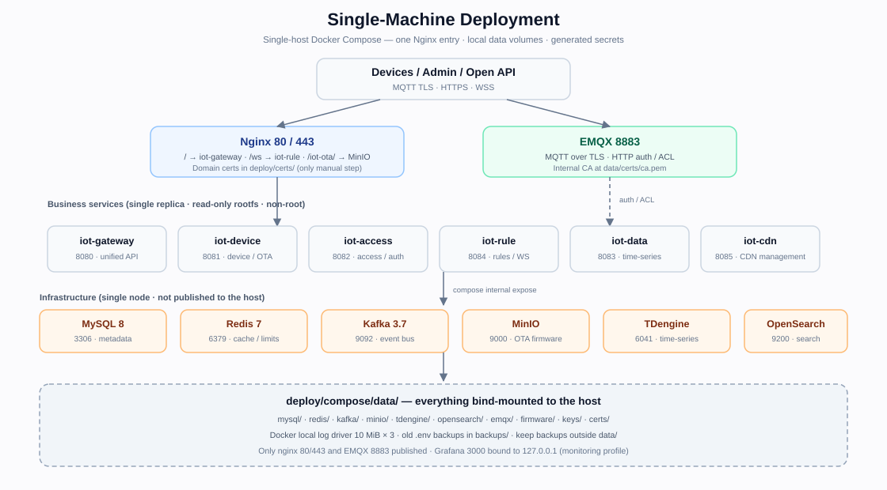

# Single-Machine Docker Compose Deployment

This guide covers production / small-scale deployment on a single Linux host using the
standalone stack in `deploy/compose/docker-compose.yml`. It is independent of the
development `docker-compose.yml` at the repository root — **do not mix the two**. For the
container list, resource limits and troubleshooting see
[`deploy/compose/README.md`](../../deploy/compose/README.md); for high availability see
[`k8s.md`](k8s.md), for multi-replica semantics see [`multi-instance.md`](multi-instance.md),
and for hardening the development stack or using external infrastructure see
[`production.md`](production.md).



> Scope: all six business services and every infrastructure component run as a **single
> replica**. A host failure takes the whole platform down; use multi-replica K8s or managed
> infrastructure when availability matters. The stack is written against vendor
> documentation; the EMQX / TDengine / MinIO items in section 8 still require on-host
> verification before going live.

## 1. Prerequisites

- Docker 24+ with Compose v2, and `openssl`.
- Run the init script as root or with sudo: it creates data directories and chowns them to
  each image's default UID. Running as non-root skips chown with a warning (containers may
  then be unable to write `data/`).
- A domain name resolved to this host; ports 80, 443 and 8883 free.
- ≥ 8 GiB RAM and ≥ 50 GiB disk recommended; the compose `mem_limit` values total about
  7 GiB. Size the host after load-testing your device count and retention period.
- **Domain certificate (the only manual file)**: `deploy/certs/fullchain.pem` and
  `deploy/certs/privkey.pem`, with a complete chain and a matching private key. You can use
  certbot; `scripts/renew-cert.sh` only runs `certbot renew`, so copy the renewed files into
  `deploy/certs/` yourself (the script does not copy them).

## 2. Initialization

```bash
sudo scripts/init-prod.sh
```

The script is idempotent. On first run it generates:

- `deploy/compose/.env` (mode 600): application keys `JWT_SECRET`, `IOT_GATEWAY_SECRET`,
  `IOT_CRED_ENCRYPT_KEY`, `IOT_PASSWORD_PEPPER`, `ADMIN_INITIAL_PASSWORD`,
  `EMQX_AUTH_SECRET`, `MQTT_USERNAME` / `MQTT_PASSWORD`; infrastructure passwords (MySQL
  root/iot, Redis, MinIO root, TDengine root, Grafana, EMQX dashboard); and `DOMAIN`,
  `PLATFORM_TENANT`, `PUID`/`PGID`, `ACCESS_CALLBACK_BASE`, `OTA_PUBLIC_BASE`, `OTA_S3_*`.
- Data directories and ownership under `deploy/compose/data/` (see section 5).
- An internal CA and EMQX server certificate under `deploy/compose/data/certs/` (SAN:
  `emqx`, `localhost`, `127.0.0.1`, `DOMAIN`); `ca.key` is not mounted into containers.
- The initial `admin` password, printed once and also stored in `.env` as
  `ADMIN_INITIAL_PASSWORD`.

**Using a real domain**: pass it on the first run; the script derives
`ACCESS_CALLBACK_BASE` (`https://<domain>/api/v1/access/oauth/callback`) and
`OTA_PUBLIC_BASE` (`https://<domain>`) and puts the domain in the internal CA/EMQX
certificate SAN:

```bash
sudo DOMAIN=iot.example.com scripts/init-prod.sh
```

If you already generated with the default `DOMAIN=iot.example.com`, edit `DOMAIN` in
`deploy/compose/.env` and run `sudo scripts/init-prod.sh --regenerate` to regenerate the
certificate. Nothing is running yet, so this early key rotation is harmless.

To validate compose syntax without a domain certificate:

```bash
SKIP_CERT_CHECK=1 scripts/init-prod.sh
docker compose -f deploy/compose/docker-compose.yml config -q
```

## 3. Start, Stop and Logs

```bash
# First run builds the six service images (iot-*-:local) and starts services after infrastructure is healthy
docker compose -f deploy/compose/docker-compose.yml up -d --build

# Optional monitoring: Prometheus + Grafana (+ kafka-exporter)
docker compose -f deploy/compose/docker-compose.yml --profile monitoring up -d

# Status and logs
docker compose -f deploy/compose/docker-compose.yml ps
docker compose -f deploy/compose/docker-compose.yml logs -f --tail=200 iot-access nginx

# Stop / recreate one service
docker compose -f deploy/compose/docker-compose.yml stop
docker compose -f deploy/compose/docker-compose.yml up -d --force-recreate iot-access
```

All persistent data is bind-mounted, so `down` does not delete `deploy/compose/data/`; do not
remove that directory by hand.

Health: `curl -fsS http://127.0.0.1/healthz` should return `ok`. Business `/ready` endpoints
are reachable only inside the compose network (nginx returns 404 for `/health`, `/ready`,
`/metrics`), so check them from the host like this:

```bash
for s in iot-gateway:8080 iot-device:8081 iot-access:8082 iot-data:8083 iot-rule:8084 iot-cdn:8085; do
  svc=${s%%:*}; port=${s##*:}
  docker compose -f deploy/compose/docker-compose.yml exec -T "$svc" \
    curl -fsS "http://127.0.0.1:$port/ready" >/dev/null \
    && echo "$svc ready" || echo "$svc NOT-READY"
done
```

## 4. Ports and Entry Points

| Entry | Description |
|------|------|
| `80` | `/healthz` returns 200; everything else 301-redirects to HTTPS |
| `443` | `/` → iot-gateway:8080; `/ws` → iot-rule:8084 (WebSocket Upgrade, 20 connections/IP) |
| `443` `/iot-ota/` | OTA firmware objects (read-only `firmware/` prefix of the MinIO `iot-ota` bucket) |
| `8883` | Device MQTT over TLS (EMQX) |
| `127.0.0.1:3000` | Grafana (monitoring profile only; use an SSH tunnel) |

MySQL, Redis, Kafka, MinIO, TDengine, OpenSearch, EMQX 1883 and dashboard 18083, plus all six
business service ports are `expose`d only on the compose network and never published to the
host. The firewall should allow only 80/443/8883. WebSocket authentication is sent via
`Sec-WebSocket-Protocol: bearer, <JWT>`; never put the JWT in the URL query. Legacy
query-token clients receive 401. iot-rule caps each process at 1024 WS connections by default
(`WS_MAX_CONNECTIONS`), and nginx limits `/ws` to 20 per IP; audit logs (including login) record the source IP.

Devices connect to `ssl://<DOMAIN>:8883` and must trust
`deploy/compose/data/certs/ca.pem` (the internal CA); iot-access itself uses
`ssl://emqx:8883` with the same CA. Device MQTT credentials are issued by an admin through
`POST /api/v1/devices/{id}/mqtt-credential`; the client id must equal the username (device id).
Deleting, disabling, or unbinding a device revokes its MQTT credentials; auth rejects `disabled`/`unbound` devices, and existing sessions must reconnect to lose access.

## 5. Data, Logs and Backups

All persistent data lives under `deploy/compose/data/` (the whole directory is gitignored):

| Directory | Contents |
|------|------|
| `mysql/` | MySQL data + binlog + `error.log` |
| `redis/` | Redis AOF (`appendonly yes`) |
| `kafka/` | Kafka KRaft data |
| `minio/` | MinIO data (OTA bucket) |
| `tdengine/`, `tdengine-log/` | TDengine data / logs |
| `opensearch/`, `opensearch-logs/` | OpenSearch data / logs |
| `emqx/`, `emqx-log/` | EMQX data / logs |
| `firmware/` | iot-device local firmware fallback |
| `keys/` | iot-access credential keyring `cred_keys.json` |
| `certs/` | Internal CA and EMQX server certificate |
| `prometheus/`, `grafana/` | Monitoring data (monitoring profile) |

Container stdout is capped by the Docker `local` log driver at 10 MiB × 3; nginx access/error
logs go to stdout/stderr; MySQL/EMQX/OpenSearch/TDengine file logs stay in the directories
above.

Backup/restore commands follow section 4 of [`production.md`](production.md), adding
`-f deploy/compose/docker-compose.yml` to each `docker compose` command. Example:

```bash
set -a; . deploy/compose/.env; set +a
mkdir -p /var/backups/iot
docker compose -f deploy/compose/docker-compose.yml exec -T mysql sh -c \
  'exec mysqldump -uroot -p"$MYSQL_ROOT_PASSWORD" --single-transaction --quick \
   --routines --triggers --events --source-data=2 --set-gtid-purged=OFF iot' \
  > "/var/backups/iot/iot-$(date +%F).sql"
```

Write backups outside `data/` and copy them off-host. `deploy/compose/backups/` only holds
old `.env` files saved by `init-prod.sh`; it is not a complete backup.

## 6. Upgrade and Rollback

1. Take a full MySQL backup and record the binlog position first (section 5 and
   production.md §4).
2. Pull the new code, rebuild and replace:

```bash
docker compose -f deploy/compose/docker-compose.yml up -d --build
```

Images use the `:local` tag and are rebuilt from the current working tree on every `--build`;
schema migrations run automatically at service startup. v1.23.0 recreates the
`alert_records.rule_id` foreign key (nullable + `ON DELETE SET NULL`) and adds indexes on first
start; back up MySQL before upgrading large tables. Configuration changes require
`up -d --force-recreate <service>`; after editing `nginx.conf` / `emqx.conf`, run
`restart nginx|emqx`.

Rollback: check out the previous git revision and run `up -d --build` again. Migrations are
forward-compatible additive changes, but after the uuid → snowflake primary-key migration
([`upgrade-legacy-ids.md`](upgrade-legacy-ids.md)) older binaries **must not** connect to the
database; restore a backup before rolling back across a destructive change.

## 7. Keys and Rotation

```bash
sudo scripts/init-prod.sh --regenerate
docker compose -f deploy/compose/docker-compose.yml up -d --force-recreate
```

- The old `.env` is backed up to `deploy/compose/backups/.env.<timestamp>` and never deleted.
- Rotated application keys: `JWT_SECRET`, `IOT_GATEWAY_SECRET`, `IOT_CRED_ENCRYPT_KEY`,
  `IOT_PASSWORD_PEPPER`, `ADMIN_INITIAL_PASSWORD`, `EMQX_AUTH_SECRET`, `MQTT_PASSWORD`.
- The previous encryption key is stored as `IOT_CRED_ENCRYPT_KEY_OLD`; the code uses it to
  decrypt version=1 rows. Only the previous key is kept — two consecutive rotations make the
  oldest data undecryptable.
- **Infrastructure passwords are not rotated automatically** (rotating them would break
  access to data already on disk): change MySQL / Redis / MinIO / TDengine / Grafana / EMQX
  dashboard passwords inside each service, then update `.env`. Old values remain in the
  backup.
- `--regenerate` also rotates the internal CA: old files are kept as `data/certs/*.old` and
  devices that trusted the old CA must install the new `ca.pem`.
- Impact: JWT rotation logs every user out; `IOT_GATEWAY_SECRET` rotation requires recreating
  all six business containers together; `MQTT_PASSWORD` changes must be propagated to the
  platform MQTT client; `ADMIN_INITIAL_PASSWORD` only applies when `admin` is re-seeded.
- If you previously rotated through the online API and generated
  `data/keys/cred_keys.json`, that file takes precedence over the environment. Keep using the
  API, or re-encrypt first; editing `.env` alone will not take effect.

## 8. Unverified Items and Pre-Launch Checks

The following are written against vendor documentation; the repository has not completed
end-to-end testing with the real heavyweight images. Verify each item before going live:

1. **EMQX**: confirm the 8883 listener, dashboard binding and HTTP auth/ACL are accepted by
   the image:

   ```bash
   docker compose -f deploy/compose/docker-compose.yml exec emqx emqx ctl conf show listeners
   docker compose -f deploy/compose/docker-compose.yml exec emqx emqx ctl conf show authentication
   docker compose -f deploy/compose/docker-compose.yml exec emqx emqx ctl conf show authorization
   ```

   Then verify allow/deny with a real device.
2. **TDengine**: `TAOS_ROOT_PASSWORD` requires an image ≥ 3.3.6.6. If `tdengine:3.3` currently
   points to an older patch, the root password remains `taosdata`; run
   `ALTER USER root PASS '...'` manually and update `.env`.
3. **MinIO / OTA**: `minio-init` grants anonymous read on the `firmware/` prefix via
   `mc anonymous set download <bucket>/firmware`. The `/iot-ota/` location in `nginx.conf`
   hardcodes the default bucket name `iot-ota`; changing `OTA_S3_BUCKET` requires updating
   that location. For tenant isolation, use CDN signing or disable `OTA_S3_*` (local
   `data/firmware`).
4. **Data directory ownership**: the script chowns to each image's default UID (EMQX/MinIO/
   OpenSearch 1000, Kafka 1001, Prometheus 65534, Grafana 472). If an image release changes
   its UID, fix ownership according to the container logs.
5. **Single replica**: any infrastructure container failure takes the whole site down;
   `mem_limit`/`cpus` are upper bounds only and must be tuned after load testing. Kafka has a
   single broker and OpenSearch a single node — no high availability.

Pre-launch checklist:

- [ ] `deploy/certs/fullchain.pem` / `privkey.pem` match the domain and the chain is complete
- [ ] `.env` is mode 600 and `DOMAIN`, `ACCESS_CALLBACK_BASE`, `OTA_PUBLIC_BASE` use the real domain
- [ ] Firewall allows only 80/443/8883; Grafana 3000 is local-only
- [ ] All six business services report `/ready` 200 and `/healthz` returns `ok`
- [ ] A real device completes MQTT TLS access and credential allow/deny verification
- [ ] MySQL backup and restore rehearsal completed; backups copied off-host
- [ ] EMQX / TDengine / data-directory ownership items in section 8 verified

## 9. Related Documentation

- Containers, resources and troubleshooting: [`deploy/compose/README.md`](../../deploy/compose/README.md)
- Hardening and external infrastructure: [`production.md`](production.md)
- Multi-replica semantics: [`multi-instance.md`](multi-instance.md)
- Kubernetes cluster: [`k8s.md`](k8s.md)
