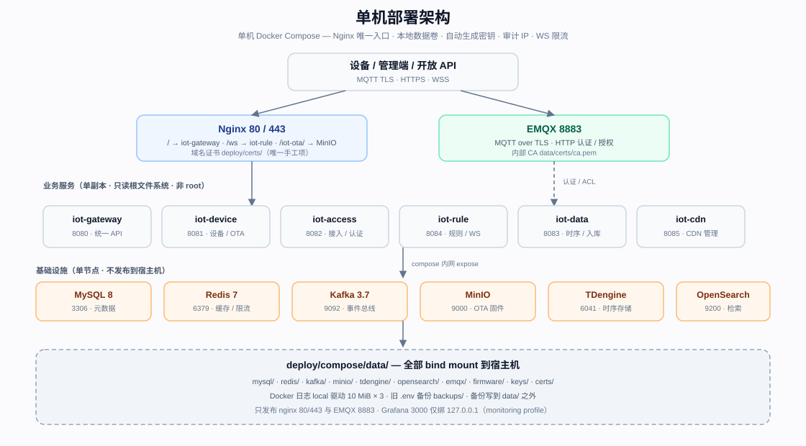

# 单机 Docker Compose 部署

本文面向一台 Linux 主机上的生产 / 小规模部署，使用仓库自带的独立编排
`deploy/compose/docker-compose.yml`。它与根目录的开发用 `docker-compose.yml` 相互独立，
**不要混用**。容器清单、资源上限与排障细节见
[`deploy/compose/README.md`](../../deploy/compose/README.md)；高可用集群见
[`k8s.md`](k8s.md)，多副本语义见 [`multi-instance.md`](multi-instance.md)，在开发编排上
自行加固或接入外部基础设施见 [`production.md`](production.md)。



> 边界：六个业务服务与所有基础设施都是**单副本**，单机故障 = 全站不可用；需要可用性时
> 改用 K8s 多副本或托管基础设施。当前编排按官方文档编写，EMQX / TDengine / MinIO 的
> 实机联调项见第 8 节，上线前必须逐项核对。

## 1. 前置条件

- Docker 24+ 与 Compose v2，`openssl` 可用。
- 以 root 或 sudo 运行初始化脚本：脚本会创建数据目录并按各镜像默认 UID chown；非 root
  运行会跳过 chown 并告警（容器可能无法写入 `data/`）。
- 域名已解析到本机；80、443、8883 端口空闲。
- 建议 ≥ 8 GiB 内存、≥ 50 GiB 磁盘；compose 中各容器 `mem_limit` 合计约 7 GiB，实际
  容量按设备量与数据保留期压测后调整。
- **域名证书（唯一需要人工提供的文件）**：`deploy/certs/fullchain.pem` 与
  `deploy/certs/privkey.pem`，证书需包含中间链且与私钥匹配。可用 certbot 申请；
  `scripts/renew-cert.sh` 只执行 `certbot renew`，续期后需自行把新文件同步到
  `deploy/certs/`（脚本不会复制）。

## 2. 初始化

```bash
sudo scripts/init-prod.sh
```

脚本是幂等的，首次运行会生成：

- `deploy/compose/.env`（权限 600）：应用密钥 `JWT_SECRET`、`IOT_GATEWAY_SECRET`、
  `IOT_CRED_ENCRYPT_KEY`、`IOT_PASSWORD_PEPPER`、`ADMIN_INITIAL_PASSWORD`、
  `EMQX_AUTH_SECRET`、`MQTT_USERNAME` / `MQTT_PASSWORD`；基础设施口令（MySQL root/iot、
  Redis、MinIO root、TDengine root、Grafana、EMQX dashboard）；以及 `DOMAIN`、
  `PLATFORM_TENANT`、`PUID`/`PGID`、`ACCESS_CALLBACK_BASE`、`OTA_PUBLIC_BASE`、
  `OTA_S3_*`。
- `deploy/compose/data/` 下的数据目录与属主（内容见第 5 节）。
- `deploy/compose/data/certs/` 下的内部 CA 与 EMQX 服务端证书（SAN 为 `emqx`、
  `localhost`、`127.0.0.1` 与 `DOMAIN`）；`ca.key` 不挂载进容器。
- 首次运行会打印 `admin` 的初始口令（同时写入 `.env` 的 `ADMIN_INITIAL_PASSWORD`）。

**使用非默认域名**：首次运行直接传入域名，脚本会据此派生
`ACCESS_CALLBACK_BASE`（`https://<域名>/api/v1/access/oauth/callback`）与
`OTA_PUBLIC_BASE`（`https://<域名>`），并把域名写入内部 CA/EMQX 证书 SAN：

```bash
sudo DOMAIN=iot.example.com scripts/init-prod.sh
```

若已用默认 `DOMAIN=iot.example.com` 生成，编辑 `deploy/compose/.env` 中的 `DOMAIN` 后
执行 `sudo scripts/init-prod.sh --regenerate` 重新生成证书；此时尚未启动，密钥轮换无副作用。

仅校验 compose 语法、尚无域名证书时：

```bash
SKIP_CERT_CHECK=1 scripts/init-prod.sh
docker compose -f deploy/compose/docker-compose.yml config -q
```

## 3. 启动、停止与日志

```bash
# 首次启动会在本机构建 6 个业务镜像（iot-*-:local），并等待基础设施健康后启动
docker compose -f deploy/compose/docker-compose.yml up -d --build

# 可选监控：Prometheus + Grafana（+ kafka-exporter）
docker compose -f deploy/compose/docker-compose.yml --profile monitoring up -d

# 状态与日志
docker compose -f deploy/compose/docker-compose.yml ps
docker compose -f deploy/compose/docker-compose.yml logs -f --tail=200 iot-access nginx

# 停止 / 重启单个服务
docker compose -f deploy/compose/docker-compose.yml stop
docker compose -f deploy/compose/docker-compose.yml up -d --force-recreate iot-access
```

所有持久数据都是 bind mount，`down` 不会删除 `deploy/compose/data/`；不要手工删除该目录。

健康检查：外部入口 `curl -fsS http://127.0.0.1/healthz` 应返回 `ok`。业务 `/ready` 只在
compose 内网可达（nginx 对 `/health`、`/ready`、`/metrics` 返回 404），在宿主机上逐个检查：

```bash
for s in iot-gateway:8080 iot-device:8081 iot-access:8082 iot-data:8083 iot-rule:8084 iot-cdn:8085; do
  svc=${s%%:*}; port=${s##*:}
  docker compose -f deploy/compose/docker-compose.yml exec -T "$svc" \
    curl -fsS "http://127.0.0.1:$port/ready" >/dev/null \
    && echo "$svc ready" || echo "$svc NOT-READY"
done
```

## 4. 端口与入口

| 入口 | 说明 |
|------|------|
| `80` | 仅 `/healthz` 返回 200，其余 301 到 HTTPS |
| `443` | `/` → iot-gateway:8080；`/ws` → iot-rule:8084（WebSocket Upgrade） |
| `443` `/iot-ota/` | OTA 固件对象（MinIO `iot-ota` bucket 的 `firmware/` 前缀，只读） |
| `8883` | 设备 MQTT over TLS（EMQX） |
| `127.0.0.1:3000` | Grafana（仅 monitoring profile，需 SSH 隧道访问） |

MySQL、Redis、Kafka、MinIO、TDengine、OpenSearch、EMQX 1883 与 dashboard 18083，以及
六个业务服务端口一律只在 compose 内网 `expose`，不发布到宿主机。防火墙只放行 80/443/8883。
WebSocket 鉴权在 `Sec-WebSocket-Protocol: bearer, <JWT>` 中传递，不要把 JWT 放进 URL query；
旧 query-token 客户端会收到 401。

设备连接 `ssl://<DOMAIN>:8883`，需信任 `deploy/compose/data/certs/ca.pem`（内部 CA）；
平台内的 iot-access 使用 `ssl://emqx:8883` + 内部 CA。设备 MQTT 凭据由 admin 通过
`POST /api/v1/devices/{id}/mqtt-credential` 逐个签发，client id 必须等于用户名（设备 id）。

## 5. 数据、日志与备份

所有持久数据位于 `deploy/compose/data/`（整个目录已 gitignore）：

| 目录 | 内容 |
|------|------|
| `mysql/` | MySQL 数据 + binlog + `error.log` |
| `redis/` | Redis AOF（`appendonly yes`） |
| `kafka/` | Kafka KRaft 数据 |
| `minio/` | MinIO 数据（OTA bucket） |
| `tdengine/`、`tdengine-log/` | TDengine 数据 / 日志 |
| `opensearch/`、`opensearch-logs/` | OpenSearch 数据 / 日志 |
| `emqx/`、`emqx-log/` | EMQX 数据 / 日志 |
| `firmware/` | iot-device 本地固件兜底目录 |
| `keys/` | iot-access 凭据密钥环 `cred_keys.json` |
| `certs/` | 内部 CA 与 EMQX 服务端证书 |
| `prometheus/`、`grafana/` | 监控数据（monitoring profile） |

容器 stdout 由 Docker `local` 日志驱动限制为 10 MiB × 3；nginx 的 access/error 日志写
stdout/stderr；MySQL/EMQX/OpenSearch/TDengine 的文件日志在上述数据目录内。

备份/恢复命令沿用 [`production.md`](production.md) 第 4 节，把 `docker compose` 命令加上
`-f deploy/compose/docker-compose.yml` 即可。示例：

```bash
set -a; . deploy/compose/.env; set +a
mkdir -p /var/backups/iot
docker compose -f deploy/compose/docker-compose.yml exec -T mysql sh -c \
  'exec mysqldump -uroot -p"$MYSQL_ROOT_PASSWORD" --single-transaction --quick \
   --routines --triggers --events --source-data=2 --set-gtid-purged=OFF iot' \
  > "/var/backups/iot/iot-$(date +%F).sql"
```

建议把备份写到 `data/` 之外并同步到异机；`deploy/compose/backups/` 只用于
`init-prod.sh` 自动保存的旧 `.env`，不代表完整备份。

## 6. 升级与回滚

1. 升级前先做 MySQL 全量备份并记录 binlog 位点（见第 5 节与 production.md §4）。
2. 拉取新代码后重建并滚动替换：

```bash
docker compose -f deploy/compose/docker-compose.yml up -d --build
```

镜像 tag 为 `:local`，每次 `--build` 使用当前工作树构建；数据库迁移在服务启动时自动执行。
配置变更需 `up -d --force-recreate <service>` 才生效；修改 `nginx.conf` / `emqx.conf` 后
`restart nginx|emqx`。

回滚：切回上一个 git revision 后同样执行 `up -d --build`。迁移是向前兼容的加列/建表，
但执行过 uuid → snowflake 主键迁移（[`upgrade-legacy-ids.md`](upgrade-legacy-ids.md)）后，
旧版本二进制禁止再连库；有破坏性变更时先恢复备份。

## 7. 密钥与轮换

```bash
sudo scripts/init-prod.sh --regenerate
docker compose -f deploy/compose/docker-compose.yml up -d --force-recreate
```

- 旧 `.env` 备份到 `deploy/compose/backups/.env.<时间戳>`，永不删除。
- 轮换的应用密钥：`JWT_SECRET`、`IOT_GATEWAY_SECRET`、`IOT_CRED_ENCRYPT_KEY`、
  `IOT_PASSWORD_PEPPER`、`ADMIN_INITIAL_PASSWORD`、`EMQX_AUTH_SECRET`、`MQTT_PASSWORD`。
- 旧加密密钥自动写入 `IOT_CRED_ENCRYPT_KEY_OLD`，代码用它解密 version=1 的旧行；只保留
  上一把，连续轮换两次会让最早一代数据无法解密。
- **基础设施口令不会自动轮换**（轮换会导致连不上已落盘数据）：MySQL / Redis / MinIO /
  TDengine / Grafana / EMQX dashboard 需人工在各自服务内修改后同步 `.env`，旧值见备份。
- `--regenerate` 也会轮换内部 CA：旧文件备份为 `data/certs/*.old`，已信任旧 CA 的设备需
  重新安装新 `ca.pem`。
- 影响：JWT 轮换后所有用户需重新登录；`IOT_GATEWAY_SECRET` 轮换需六个业务容器同批重建；
  `MQTT_PASSWORD` 变更需同步平台侧 MQTT 客户端；`ADMIN_INITIAL_PASSWORD` 只在重新播种
  `admin` 时生效。
- 若曾通过在线接口轮换并生成了 `data/keys/cred_keys.json`，该文件优先于环境变量；继续用
  接口轮换，或先重加密再改 `.env`，否则只改 `.env` 不生效。

## 8. 未验证项与上线前检查

以下按官方文档编写，仓库未在真实重型镜像上完成端到端联调，上线前逐项核对：

1. **EMQX**：确认 8883 listener、dashboard 绑定与 HTTP auth/ACL 被镜像接受：

   ```bash
   docker compose -f deploy/compose/docker-compose.yml exec emqx emqx ctl conf show listeners
   docker compose -f deploy/compose/docker-compose.yml exec emqx emqx ctl conf show authentication
   docker compose -f deploy/compose/docker-compose.yml exec emqx emqx ctl conf show authorization
   ```

   并用真实设备验证 allow/deny。
2. **TDengine**：`TAOS_ROOT_PASSWORD` 需要镜像 ≥ 3.3.6.6；若 `tdengine:3.3` 当前指向更旧
   补丁，root 口令仍是 `taosdata`，需手工 `ALTER USER root PASS '...'` 并同步 `.env`。
3. **MinIO / OTA**：`minio-init` 用 `mc anonymous set download <bucket>/firmware` 给固件
   前缀匿名读权限；`nginx.conf` 的 `/iot-ota/` 按默认 bucket 名 `iot-ota` 写死，修改
   `OTA_S3_BUCKET` 时需同步修改该 location。需要租户隔离时改用 CDN 签名或不启用
   `OTA_S3_*`（改用本地 `data/firmware`）。
4. **数据目录属主**：脚本按官方镜像默认 UID chown（EMQX/MinIO/OpenSearch 1000、Kafka
   1001、Prometheus 65534、Grafana 472）。镜像版本变更 UID 时按容器日志修正。
5. **单副本**：任一基础设施容器故障即全站不可用；`mem_limit`/`cpus` 只是上限，需按实际
   容量压测。Kafka 单 broker、OpenSearch 单节点，无高可用。

上线检查清单：

- [ ] `deploy/certs/fullchain.pem` / `privkey.pem` 与域名匹配，证书链完整
- [ ] `.env` 权限 600，`DOMAIN` 与 `ACCESS_CALLBACK_BASE` / `OTA_PUBLIC_BASE` 已改为真实域名
- [ ] 防火墙只放行 80/443/8883，Grafana 3000 仅本机
- [ ] 六个业务服务 `/ready` 全部 200，`/healthz` 返回 `ok`
- [ ] 真实设备完成 MQTT TLS 接入与凭据 allow/deny 验证
- [ ] MySQL 备份与恢复演练完成，备份已同步到异机
- [ ] EMQX / TDengine / 数据目录属主等第 8 节未验证项逐项确认

## 9. 相关文档

- 容器、资源与排障：[`deploy/compose/README.md`](../../deploy/compose/README.md)
- 加固与外部基础设施：[`production.md`](production.md)
- 多副本语义：[`multi-instance.md`](multi-instance.md)
- K8s 集群：[`k8s.md`](k8s.md)
