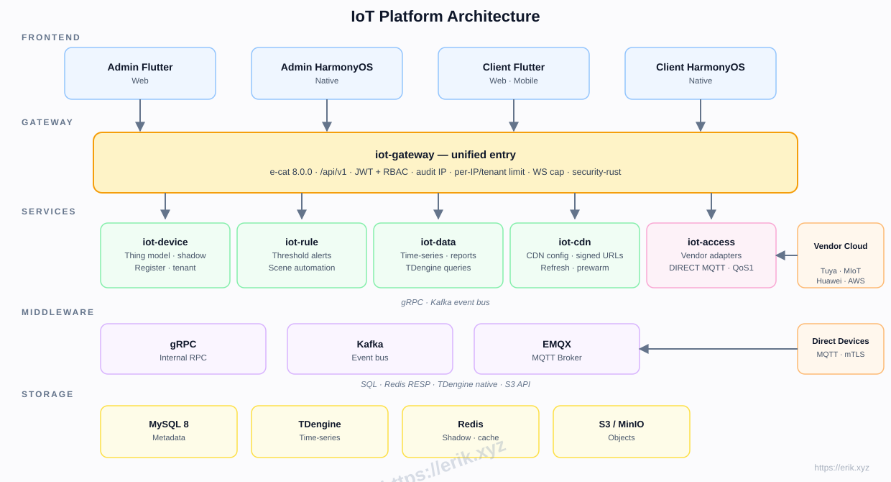
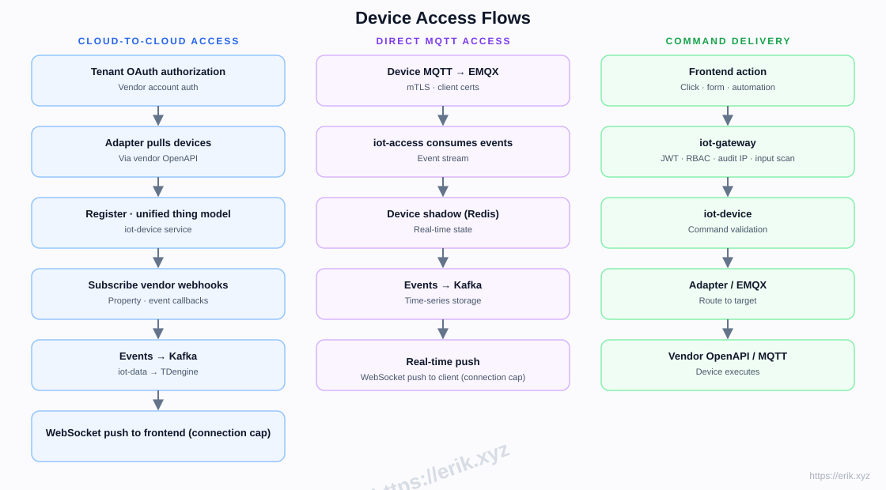
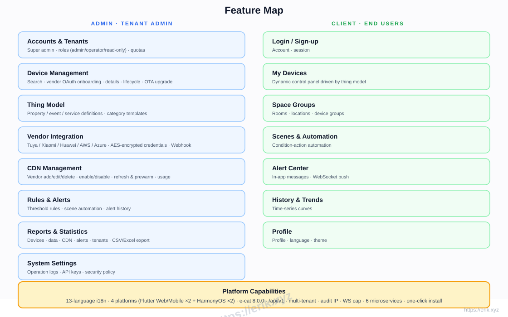
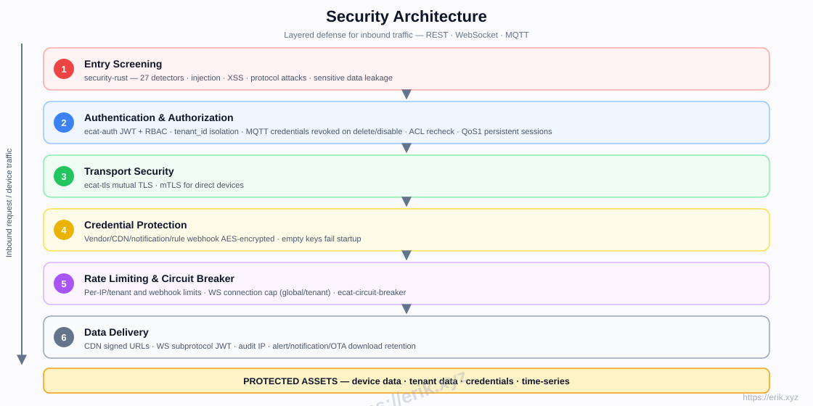

# IoT Platform

[中文](../../README.md) | [English](README.en.md)

<p align="center">
  
</p>

A one-stop SaaS IoT platform that unifies access to major device vendors at home and abroad (Tuya, Xiaomi, Huawei, AWS IoT, Azure IoT, etc.), providing device management, thing models, rules & alerts, time-series data, CDN delivery, and multi-platform apps. The backend is a Rust microservice workspace (e-cat), the frontends are Flutter + HarmonyOS. The UI supports 13 languages; the documentation is provided in Chinese / English.

## Features

- **Multi-vendor access**: cloud-to-cloud OAuth (Tuya / Xiaomi / Huawei / AWS / Azure) + vendor AK/SK configuration in the admin console; direct MQTT with TLS / mTLS and username/password
- **Thing model**: unified modeling of property / event / service — modeled in admin, rendered dynamically in client
- **Device lifecycle**: register → enable / disable → unbind → delete, with online / offline runtime status; device detail (thing model, alerts, commands, tags), groups and batch creation
- **Rules & alerts**: threshold rules, scene automation (property / time conditions + command / notification actions, manual execution), notification inbox, notification channels, real-time WebSocket push
- **Data & reports**: TDengine time-series storage, history curves, CSV export
- **OTA upgrades**: firmware registration by URL or binary upload, S3 / MinIO storage, CDN signed download URLs, download stats, grayscale batch rollout by device hash, rollback on failure
- **CDN management**: vendor config, enable/disable, refresh & prewarm, signed URLs
- **Multi-tenant SaaS**: tenant isolation, quotas, roles (admin / operator / read-only)
- **Security**: security-rust inbound scanning, JWT + RBAC, mutual TLS, AES-encrypted credentials, rate limiting & circuit breaker
- **Observability & benchmarking**: Prometheus `/metrics`, alert rules (service down / 5xx / P95 / Kafka lag + kafka-exporter), `ecat-bench` CLI and `scripts/bench.sh`
- **13-language UI**, across Flutter Web / Mobile and native HarmonyOS (4 apps)

## Architecture



## Device Access Flows



## Feature Map



## Device Lifecycle


## Security Architecture



## Tech Stack

| Layer | Technology |
|----|------|
| Frontend | Flutter (Web / Mobile) · HarmonyOS ArkTS |
| Backend | Rust (axum · tokio · gRPC) · security-rust scanning |
| Middleware | EMQX (MQTT) · Kafka (event bus) · gRPC (internal RPC) |
| Storage | MySQL 8 (metadata) · TDengine (time-series) · Redis (shadow / cache) · S3 / MinIO (objects) |
| Access | Cloud-to-cloud OAuth adapters · direct MQTT (mTLS) |

## Repository Layout

```
├── apps/            # Frontend apps
│   ├── admin/       # Admin console (Flutter + HarmonyOS)
│   └── client/      # Client app (Flutter + HarmonyOS)
├── e-cat/           # Rust workspace (framework + business microservices)
│   └── ecat*/       # Shared framework crates + services (ecat-gateway · ecat-device · ecat-access · ecat-rule · ecat-data-service · ecat-cdn · ecat-edge …)
├── docs/            # Docs, diagrams, donation images
├── scripts/         # Build / validation / smoke / benchmark scripts (install.sh · bench.sh · loadtest.sh)
└── docker-compose.yml  # Infrastructure (MySQL / Redis / EMQX / Kafka / MinIO / TDengine)
```

## One-Click Install

```bash
git clone https://github.com/erikwang2013/iot-platform.git
cd iot-platform
./scripts/install.sh
```

The script automatically: starts the infrastructure (MySQL / Redis / EMQX / Kafka / MinIO / TDengine) → builds the 6 business services → generates the .env config → prints the service list and start commands. Safe to run repeatedly.

## Installation Guide

### Prerequisites

- Docker 24+ and docker compose (or docker-compose)
- Rust 1.80+ (stable, for building the services; the script builds automatically if cargo is installed)
- Port availability: 8080-8085, 3306, 6379, 1883, 9092, 9000-9001, 6041 must be free

### Installation Steps

1. Start the infrastructure: `./scripts/install.sh` runs `docker compose up -d`
2. Build services: the script runs `cargo build --release` when cargo is detected, outputting binaries to `scripts/bin/` (or use the ones under `e-cat/target/release/`)
3. Start services: launch the 6 services one by one with the commands printed at the end of the script
4. Database migration: runs automatically on service start; on first boot iot-access creates the default tenant and admin account

### Environment Variables (selected)

| Variable | Service | Notes |
|------|------|------|
| `OTA_S3_ENDPOINT` / `OTA_S3_REGION` / `OTA_S3_BUCKET` / `OTA_S3_ACCESS_KEY` / `OTA_S3_SECRET_KEY` | iot-device | Store firmware in S3 / MinIO; endpoint, bucket and keys must be set together (partial configuration makes upload return 500 instead of silently falling back to local disk); `OTA_S3_REGION` defaults to `us-east-1` |
| `OTA_PUBLIC_BASE` | iot-device | Public origin prefix used to turn `s3://bucket/key` or relative paths into CDN-signable URLs |
| `OTA_CDN_PROVIDER_ID` | iot-device | iot-cdn vendor used to sign firmware download URLs; when unset, task URLs fall back to the unsigned origin URL |
| `OTA_SIGN_EXPIRES_SECS` | iot-device | Signed URL TTL, 60–86400 seconds, default 3600 |
| `CDN_BASE` | iot-gateway / iot-device | Internal iot-cdn address, default `http://localhost:8085` |
| `MQTT_URL` | iot-access | `tcp://` / `ssl://` / `mqtts://`, default `tcp://localhost:1883` |
| `MQTT_TLS` | iot-access | `1/0`; a TLS URL scheme combined with `0` fails at startup instead of downgrading to plaintext |
| `MQTT_CA_FILE` / `MQTT_CERT_FILE` / `MQTT_KEY_FILE` | iot-access | Custom CA / client certificate and key (mTLS; certificate and key must be set together) |
| `MQTT_USERNAME` / `MQTT_PASSWORD` | iot-access | Must be set together |
| `MQTT_CLIENT_ID` | iot-access | Optional, default `ecat-mqtt` |

See the [production deployment guide](../deploy/production.md) for the full variable list, key generation and hardening.

## Usage

### Login

- Admin console: log in with the default account `admin / admin123` (tenant `tenant-1`)

### Service Ports

| Service | Port |
|------|------|
| iot-gateway (gateway / public API) | 8080 |
| iot-device (device service) | 8081 |
| iot-access (ingress / auth) | 8082 |
| iot-data (data service) | 8083 |
| iot-rule (rule engine) | 8084 |
| iot-cdn (CDN management) | 8085 |
| MySQL / Redis / EMQX / Kafka / MinIO / TDengine | 3306 / 6379 / 1883 / 9092 / 9000 / 6041 |

### Module Usage

- **Device management**: add devices in the admin console → choose vendor OAuth or direct MQTT; device details show online status, thing model, alerts and tags and support sending commands; groups, batch creation and batch group membership are supported
- **Thing model**: define property / event / service for device categories; the client dashboard renders automatically
- **Rules & alerts**: configure threshold rules and scene automation; scenes support property / time conditions and command / notification actions and can run manually; alerts and scene notifications go to the notification inbox, with real-time WebSocket push on trigger
- **History data**: iot-data stores time-series data; view history curves in admin / client and export CSV
- **Reports & statistics**: multi-dimensional reports on devices / data / CDN / alerts / tenants
- **OTA upgrades**: register a firmware URL in the admin console (or upload a binary through iot-device) → create a single-device or grayscale batch task → devices report progress; signed download URLs, download stats and rollback on failure are supported
- **CDN management**: configure multi-vendor CDN with refresh / prewarm and signed URLs
- **Multi-vendor access**: cloud-to-cloud OAuth adapters for Tuya / Xiaomi / Huawei / AWS / Azure, with vendor AK/SK configuration in the admin console

### Admin Endpoints

See [docs/open-api.md](../open-api.md) for the open API. The following OTA / scene / notification endpoints are available to admin-console roles only; open API keys cannot reach them:

| Method / Path | Description |
|------|------|
| `GET/POST /api/ota/firmwares` | List / register firmware (URL) |
| `DELETE /api/ota/firmwares/{id}` | Delete firmware (S3 object is deleted too) |
| `POST /api/ota/firmwares/{id}/signed-url` | Create a CDN signed download URL (`expires_secs` optional, 60–86400) |
| `GET /api/ota/firmwares/{id}/downloads` | Download count and last download time |
| `GET/POST /api/ota/tasks` | List / create upgrade tasks (response includes `download_url`) |
| `POST /api/ota/tasks/batch` | Grayscale batch creation by `rollout_percent` (1–100), at most 1000 devices per request |
| `POST /api/ota/tasks/{id}/report` | Device reports `downloading` / `installing` / `success` / `failed` |
| `POST /api/ota/tasks/{id}/rollback` | Roll back an upgrade task |
| `GET/POST /api/rule/scenes`, `PUT/DELETE /api/rule/scenes/{id}` | Scene CRUD |
| `POST /api/rule/scenes/{id}/execute` | Execute a scene immediately (works even when disabled) |
| `GET /api/rule/notifications?unread=1` | Notification list (newest first, at most 100) |
| `POST /api/rule/notifications/{id}/read` | Mark a notification as read |

### Benchmarking

```bash
./scripts/bench.sh                              # 3 /health targets, 1000 requests / concurrency 10 / warmup 100
N=5000 C=50 TOKEN=<jwt> ./scripts/bench.sh      # custom request count, concurrency and auth
GATEWAY_URL=http://host:8080/health ./scripts/bench.sh
```

Exit codes: `0` no failed requests on any target; `1` any target had failed requests; `2` usage error. The script is a smoke / load tool, not a CI performance gate; you can also run `cargo run -p ecat-bench --bin bench -- --url ... --json` directly.

## Implementation Phases

| Phase | Scope |
|------|------|
| P0 Skeleton | Repo structure, iot-gateway + iot-device + Docker orchestration (MySQL/Redis/EMQX/Kafka/MinIO) |
| P1 Access | iot-access + Tuya adapter + direct MQTT |
| P2 Data | iot-data + TDengine + history curves |
| P3 Rules | iot-rule alerts + scene automation |
| P4 Multi-vendor + CDN | Xiaomi/Huawei/AWS/Azure adapters + iot-cdn |
| P5 Frontend | apps/admin + apps/client full-stack |
| P6 Launch | Security hardening, load testing, OTA |

## Open Source and Commercial Editions

The same codebase is delivered as open-source and commercial editions: the open-source edition targets personal study and research, while the commercial edition targets production delivery with commercial licensing, deployment and support. See the [edition comparison](https://package.erik.xyz/iot-platform/en.html#editions); for commercial licensing, contact **erik@erik.xyz**.

## Support & Donations

Your support keeps this project going. Donations are greatly appreciated!

### Scan to Donate (WeChat Pay / Alipay)

<p>
  
  
</p>

WeChat Pay · Alipay

## Project License

Copyright (c) 2026 erik <erik@erik.xyz> — https://erik.xyz

- This project is provided for personal study and research only.
- Commercial use of any kind is prohibited without prior written authorization from the author (including but not limited to commercial deployment, paid services, resale, SaaS operation, and providing commercial services based on this project).
- For commercial licensing, contact **erik@erik.xyz**.
- Unauthorized commercial use will be pursued for legal liability worldwide, and the author reserves the right to pursue such liability for life.
- Third-party components remain under their original licenses; visual assets are governed by ASSETS-LICENSE.md where applicable.


## Project Pet Expressions · IoT Bot

<table align="center">
<tr><td align="center"><br><b>Smile</b><br><code>:emoji-smile:</code></td><td align="center"><br><b>Joy</b><br><code>:emoji-joy:</code></td><td align="center"><br><b>Cry</b><br><code>:emoji-cry:</code></td><td align="center"><br><b>Depressed</b><br><code>:emoji-depressed:</code></td><td align="center"><br><b>Terrified</b><br><code>:emoji-terrified:</code></td><td align="center"><br><b>Angry</b><br><code>:emoji-angry:</code></td></tr>
<tr><td align="center"><br><b>Coquettish</b><br><code>:emoji-coquettish:</code></td><td align="center"><br><b>Cute</b><br><code>:emoji-cute:</code></td><td align="center"><br><b>Pleasing</b><br><code>:emoji-pleasing:</code></td><td align="center"><br><b>Knocking</b><br><code>:emoji-knocking:</code></td><td align="center"><br><b>Facepalm</b><br><code>:emoji-facepalm:</code></td><td align="center"><br><b>Tongue</b><br><code>:emoji-tongue:</code></td></tr>
</table>

> 12 colorful animated expressions: Smile / Joy / Cry / Depressed / Terrified / Angry / Coquettish / Cute / Pleasing / Knocking / Facepalm / Tongue. Each SVG includes a facial expression, mood effects and overall animation, and respects `prefers-reduced-motion`.
<!-- pet-expressions:end -->

<!-- assets-license:start -->
## Visual Assets License

The project pet, images, icons and expressions in this repository (including the
SVG / PNG files under `docs/pet-expressions/`) **are not open-source assets**; copyright remains with the author. Copying, modification, redistribution or
commercial use requires written permission; for commercial licensing contact **erik@erik.xyz**. See
[ASSETS-LICENSE.md](../../ASSETS-LICENSE.md).

> The code remains under the repository `LICENSE`; third-party assets (such as the clearly marked Go Gopher) remain under their original licenses.
<!-- assets-license:end -->
